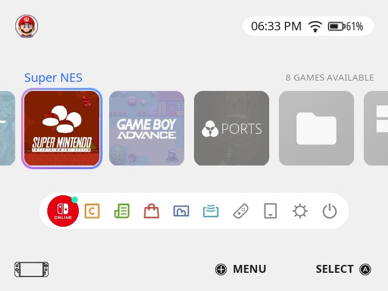
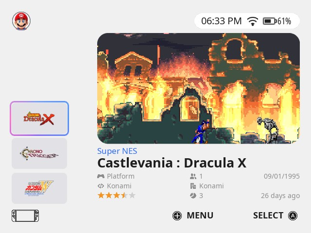
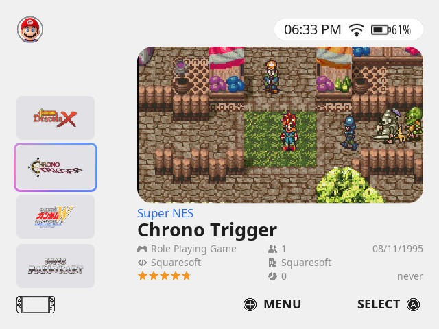
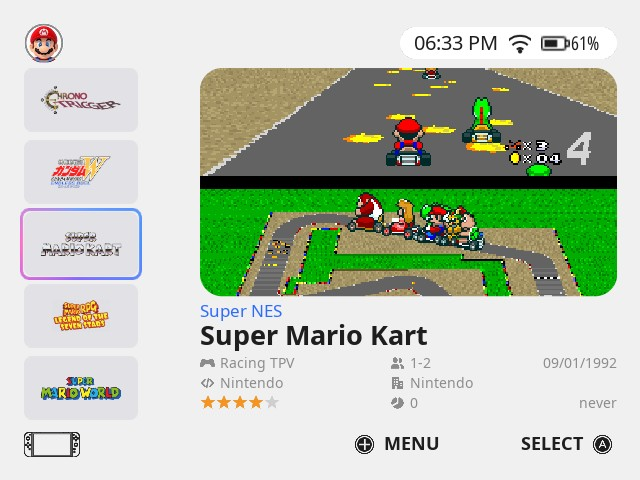

# es-theme-switch2-fcamod

**EN** · [BR](README.pt-BR.md)

 [](LICENSE) [](https://www.reddit.com/user/jovemlcxx/) [](https://ko-fi.com/jovemlcxx)

Nintendo Switch 2 home screen theme for **EmulationStation-fcamod** on the **R36S** and clones (ArkOS family, 640×480): your profile, a row of square tiles with the colour ring, the dock, and a handheld-style game list. Light or pure black (OLED).

<p align="center">
   <br>
   
</p>

[Install](#install) · [The theme](#the-theme) · [Options](#options) · [Wallpapers](#wallpapers) · [Compatibility](#compatibility) · [Customize](#customize) · [Credits](#credits-and-license)

## Install

1. Download this repository (**Code → Download ZIP**) or clone it.
2. Copy the folder to the themes folder of your device: `/roms/themes/` (the `themes` folder of the games partition) or `~/.emulationstation/themes/`. It must be named `es-theme-switch2-fcamod` (or `es-theme-switch2-fcamod-main` from the ZIP). When updating, delete the old folder first.
3. **START → UI Settings → Theme Set → es-theme-switch2-fcamod**. The options are in **UI Settings → Theme Configuration**.

Leave the frontend's **Gamelist View Style** and **Grid Size** on **automatic**: other values replace the theme's game list layout.

## The theme

- **System screen:** profile at the top left; clock, wifi and battery at the top right on a pill (so they never get lost over a wallpaper); the name of the selected system in blue over a row of square tiles (a linear row: no tile grows, and it is drawn past both edges of the screen); the colour ring marks the selected one; the dock under it.
- **Game list:** a column of banners with each game's **wheel / marquee** at the left (the selected game is the middle one and the list moves around it, as in the XMB theme), the game's **image** big at the right in a rounded card, with its system, name and data under it: genre, players, release date, developer, publisher, rating, times played and last played.
- **Button legend** (on by default, can be turned off): menu and confirm button at the bottom right, in Nintendo/Xbox (A B X Y) or PlayStation style.
- **Light and pure black (OLED)** for the whole interface, and for the settings menus.
- **Wallpapers:** 20 slots with optional animated video; the default is the plain Switch 2 background.
- **26 languages** (same as the other themes): every option follows the frontend language.
- A tile for every platform of the ArkOS family (platforms without a picture of their own show a folder), navigation sounds cut from the Switch 2 menu video.

## Options

| Option | Choices (default first) | Notes |
|---|---|---|
| Aspect Ratio | 4:3 | 640×480 screens (R36S, RG351MP...). |
| Wallpaper | 1 to 20 | `1` is the plain background; see [Wallpapers](#wallpapers). |
| Color Scheme | Light / Dark | Dark is pure black, for OLED screens. |
| Background Video | Enabled / Disabled | Disable it on slow devices; the wallpaper image is used instead. |
| Selection Outline | Enabled / Disabled | The colour ring of the selected system. It stays fixed in the middle while the row moves behind it: turn it off if you do not like that. |
| Button Icons | Nintendo / Xbox, PlayStation | PlayStation follows the button position: A = ○, B = ✕. |
| Confirm Button (A/B) | A / B | Use **B** if you swapped A/B in the system (dArkOSen ships swapped). |
| Button Legend | Enabled / Disabled | The menu / confirm legend at the bottom. |

## Wallpapers

Each of the 20 slots is an **image** (`bg_<n>.png`) and, optionally, an **animated video** (`bg_<n>.mp4`) that plays on top of it. Slot 1 is the plain background and needs no file.

1. Make it **640×480**: the theme stretches it to the whole screen.
2. Video (optional): 640×480 `.mp4`, short (10 to 30 s, it loops), no sound, 30 fps, under ~20 MB.
3. Name both files with a free slot number from 2 to 20 (e.g. `bg_2.png` and `bg_2.mp4`), copy them to `_inc/background/` and pick the number in **Theme Configuration → Wallpaper**.

```
ffmpeg -i input.mp4 -vf "scale=640:480:force_original_aspect_ratio=increase,crop=640:480" -an -r 30 -c:v libx264 -crf 23 -movflags +faststart bg_2.mp4
ffmpeg -i bg_2.mp4 -frames:v 1 bg_2.png
```

Keep a copy of your `bg_*` files before updating the theme.

## Compatibility

What has actually been tested, and how:

| | Theme |
|---|---|
| dArkOS4Clone | ✅ |
| ArkOS, arkos4clone, dArkOS, dArkOSRE-R36, dArkOSen | 🧪 |
| Batocera, Knulli, EmuELEC, ArchR, muOS | not tested |

- ✅ **Validated on real hardware** (R36S): system screen, game list, clock, wifi and battery, light and dark, button legend.
- 🧪 **Waiting for feedback:** same frontend family and same theme elements as the Xbox, PS5 and XMB themes, which are checked against each system's EmulationStation.

Known limits of fcamod that a theme cannot change: unselected system tiles are drawn at 50 % opacity, rounded corners of your game images cannot be drawn (the banners are plain rectangles), the wifi icon is a fixed picture (always shown).

**Help test your system:** tell me your system, its version and what looks wrong, by [opening an issue](https://github.com/jovemlcxx/es-theme-switch2-fcamod/issues) or [on Reddit](https://www.reddit.com/user/jovemlcxx/) (u/jovemlcxx).

## Customize

| What | Where |
|---|---|
| Profile picture | `_inc/images/avatar.png` (square or round, 128×128 or more) |
| System tile | `_inc/systems/icons/<theme>.png` (256×256, rounded corners drawn in) |
| Wallpapers | `_inc/background/bg_<n>.png` · `.mp4` (640×480) |
| Colors (whole interface and menus) | `_inc/colors/light.xml`, `dark.xml` |
| Translations | `_inc/lang/<code>.xml` |
| Layout | `aspect-ratio-4-3.xml` (written in pixels of 640×480) |

Files are named after the system's `<theme>` entry in `es_systems.cfg` (e.g. `snes`, `megadrive`), not the ROM folder.

## Credits and license

**Design reference:** the Nintendo Switch 2 home screen. Not affiliated with or endorsed by Nintendo; Nintendo Switch and its symbols are trademarks of Nintendo. The default avatar and the navigation sounds come from Nintendo's own software (© Nintendo). System tiles come from the [Switch themes](https://github.com/lilbud/es-theme-switch) by lilbud (CC BY-NC-SA), the same ones of the Xbox and PS5 themes. Font: Noto Sans (SIL Open Font License 1.1).

**License:** [CC BY-NC-SA 4.0](LICENSE). Free: selling it, alone or bundled with devices, SD cards or images, is not allowed.

**Support:** if this theme is useful to you, you can support my work on [Ko-fi](https://ko-fi.com/jovemlcxx). Thank you! ☕

[](https://ko-fi.com/jovemlcxx)
