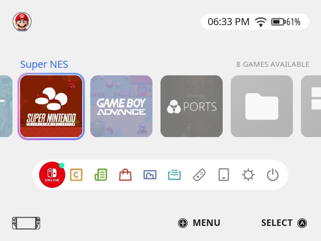
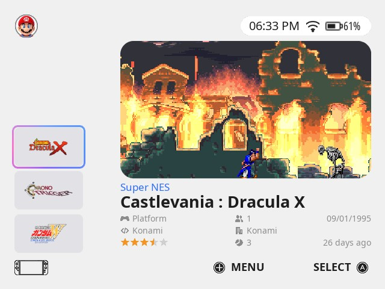
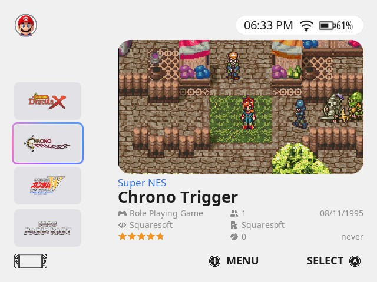
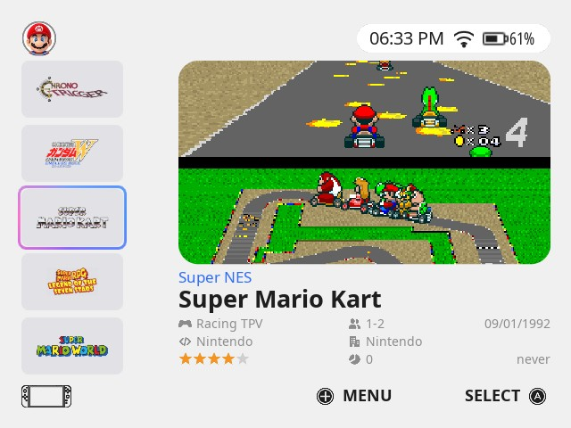

# es-theme-switch2-fcamod

[EN](README.md) · **BR**

 [](LICENSE) [](https://www.reddit.com/user/jovemlcxx/) [](https://ko-fi.com/jovemlcxx)

Tema da tela inicial do Nintendo Switch 2 para o **EmulationStation-fcamod** no **R36S** e clones (família ArkOS, 640×480): seu perfil, uma fileira de blocos quadrados com o anel colorido, o dock e uma lista de jogos no estilo do portátil. Claro ou preto puro (OLED).

<p align="center">
   <br>
   
</p>

[Instalação](#instalação) · [O tema](#o-tema) · [Opções](#opções) · [Papéis de parede](#papéis-de-parede) · [Compatibilidade](#compatibilidade) · [Personalizar](#personalizar) · [Créditos e licença](#créditos-e-licença)

## Instalação

1. Baixe este repositório (**Code → Download ZIP**) ou clone-o.
2. Copie a pasta para a pasta de temas do aparelho: `/roms/themes/` (a pasta `themes` da partição de jogos) ou `~/.emulationstation/themes/`. Ela deve se chamar `es-theme-switch2-fcamod` (ou `es-theme-switch2-fcamod-main`, vinda do ZIP). Ao atualizar, apague a pasta antiga antes.
3. **START → CONFIGURAR INTERFACE → TEMA → es-theme-switch2-fcamod**. As opções ficam em **CONFIGURAR INTERFACE → CONFIGURAÇÕES DE TEMA**.

Deixe o **MODO DE VISUALIZAÇÃO, LISTA DE JOGO** e o **TAMANHO DA GRADE** do frontend em **automático**: outros valores substituem o layout da lista de jogos do tema.

## O tema

- **Tela de sistemas:** perfil no canto superior esquerdo; relógio, wifi e bateria no canto superior direito, sobre uma pílula (para não se perderem sobre um papel de parede); o nome do sistema selecionado em azul sobre uma fileira de blocos quadrados (uma fileira linear: nenhum bloco cresce, e ela é desenhada além das duas bordas da tela); o anel colorido marca o selecionado; o dock embaixo.
- **Lista de jogos:** uma coluna de banners com o **wheel / marquee** de cada jogo à esquerda (o jogo selecionado é o do meio e a lista se move em volta dele, como no tema XMB), a **imagem** do jogo grande à direita num cartão arredondado, com o sistema, o nome e os dados embaixo: gênero, jogadores, lançamento, desenvolvedora, publicadora, nota, vezes jogado e última vez jogado.
- **Legenda dos botões** (ativada por padrão, dá para desativar): menu e botão de confirmar no canto inferior direito, no estilo Nintendo/Xbox (A B X Y) ou PlayStation.
- **Claro e preto puro (OLED)** para toda a interface e para os menus de configuração.
- **Papéis de parede:** 20 espaços com vídeo animado opcional; o padrão é o fundo liso do Switch 2.
- **26 idiomas** (os mesmos dos outros temas): todas as opções seguem o idioma do frontend.
- Um bloco para cada plataforma da família ArkOS (as que não têm imagem própria mostram uma pasta), sons de navegação cortados do vídeo do menu do Switch 2.

## Opções

| Opção | Escolhas (padrão primeiro) | Observações |
|---|---|---|
| Proporção de Tela | 4:3 | Telas 640×480 (R36S, RG351MP...). |
| Papel de Parede | 1 a 20 | O `1` é o fundo liso; veja [Papéis de parede](#papéis-de-parede). |
| Esquema de Cores | Claro / Escuro | O escuro é preto puro, para telas OLED. |
| Vídeo de Fundo | Ativado / Desativado | Desative em aparelhos lentos; a imagem do papel de parede é usada no lugar. |
| Contorno da Seleção | Ativado / Desativado | O anel colorido do sistema selecionado. Ele fica parado no meio enquanto a fileira se move atrás: desative se não gostar disso. |
| Ícones dos Botões | Nintendo / Xbox, PlayStation | O PlayStation segue a posição dos botões: A = ○, B = ✕. |
| Botão de Confirmar (A/B) | A / B | Use **B** se você inverteu A/B no sistema (o dArkOSen já vem invertido). |
| Legenda dos Botões | Ativado / Desativado | A legenda de menu / confirmar no rodapé. |

## Papéis de parede

Cada um dos 20 espaços é uma **imagem** (`bg_<n>.png`) e, opcionalmente, um **vídeo animado** (`bg_<n>.mp4`) que toca por cima dela. O espaço 1 é o fundo liso e não precisa de arquivo.

1. Faça em **640×480**: o tema estica o papel de parede para a tela inteira.
2. Vídeo (opcional): `.mp4` 640×480, curto (10 a 30 s, ele repete), sem som, 30 fps, abaixo de ~20 MB.
3. Dê aos dois arquivos o número de um espaço livre de 2 a 20 (por exemplo `bg_2.png` e `bg_2.mp4`), copie para `_inc/background/` e escolha o número em **CONFIGURAÇÕES DE TEMA → Papel de Parede**.

```
ffmpeg -i entrada.mp4 -vf "scale=640:480:force_original_aspect_ratio=increase,crop=640:480" -an -r 30 -c:v libx264 -crf 23 -movflags +faststart bg_2.mp4
ffmpeg -i bg_2.mp4 -frames:v 1 bg_2.png
```

Guarde uma cópia dos seus arquivos `bg_*` antes de atualizar o tema.

## Compatibilidade

O que foi realmente testado, e como:

| | Tema |
|---|---|
| dArkOS4Clone | ✅ |
| ArkOS, arkos4clone, dArkOS, dArkOSRE-R36, dArkOSen | 🧪 |
| Batocera, Knulli, EmuELEC, ArchR, muOS | não testado |

- ✅ **Validado no aparelho** (R36S): tela de sistemas, lista de jogos, relógio, wifi e bateria, claro e escuro, legenda dos botões.
- 🧪 **Aguardando retorno:** mesma família de frontend e mesmos elementos de tema do Xbox, PS5 e XMB, que são conferidos contra o EmulationStation de cada sistema.

Limites do fcamod que um tema não consegue mudar: os blocos de sistema não selecionados são desenhados com 50 % de opacidade, os cantos arredondados das imagens dos jogos não podem ser desenhados (os banners são retângulos) e o ícone de wifi é uma imagem fixa (sempre aparece).

**Ajude a testar o seu sistema:** me conte qual é o sistema, a versão e o que parece errado, [abrindo uma issue](https://github.com/jovemlcxx/es-theme-switch2-fcamod/issues) ou [pelo Reddit](https://www.reddit.com/user/jovemlcxx/) (u/jovemlcxx).

## Personalizar

| O quê | Onde |
|---|---|
| Foto do perfil | `_inc/images/avatar.png` (quadrada ou redonda, 128×128 ou mais) |
| Bloco do sistema | `_inc/systems/icons/<tema>.png` (256×256, cantos arredondados já desenhados) |
| Papéis de parede | `_inc/background/bg_<n>.png` · `.mp4` (640×480) |
| Cores (toda a interface e menus) | `_inc/colors/light.xml`, `dark.xml` |
| Traduções | `_inc/lang/<código>.xml` |
| Layout | `aspect-ratio-4-3.xml` (escrito em pixels de 640×480) |

Os arquivos levam o nome de tema do sistema (a tag `<theme>` do `es_systems.cfg`, por exemplo `snes`, `megadrive`), não o da pasta de ROMs.

## Créditos e licença

**Referência de design:** a tela inicial do Nintendo Switch 2. Sem afiliação nem endosso da Nintendo; Nintendo Switch e seus símbolos são marcas da Nintendo. O avatar padrão e os sons de navegação vêm do software da própria Nintendo (© Nintendo). Os blocos dos sistemas vêm dos [temas Switch](https://github.com/lilbud/es-theme-switch) de lilbud (CC BY-NC-SA), os mesmos dos temas Xbox e PS5. Fonte: Noto Sans (SIL Open Font License 1.1).

**Licença:** [CC BY-NC-SA 4.0](LICENSE). Gratuito: é proibido vendê-lo, sozinho ou junto com aparelhos, cartões SD ou imagens.

**Apoio:** se este tema for útil para você, pode apoiar meu trabalho no [Ko-fi](https://ko-fi.com/jovemlcxx). Obrigado! ☕

[](https://ko-fi.com/jovemlcxx)
